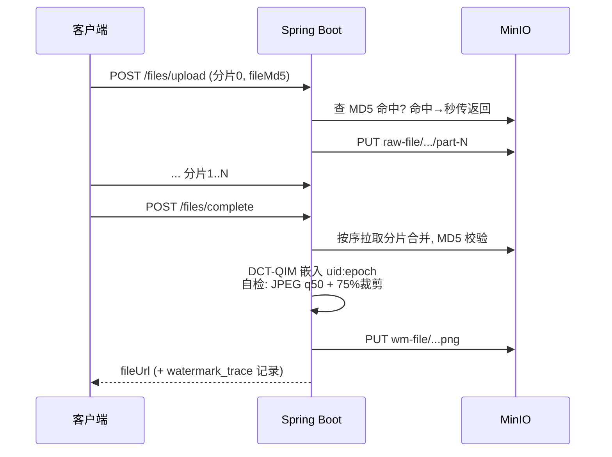

# minio-blind-watermark-upload

MinIO 分片上传 + 纯 Java 图片盲水印 demo。两个接口完成「上传 → 合并 → 嵌水印 → 溯源」全链路。

- **上传**：分片上传，MD5 秒传、分片级幂等、断点可续
- **水印**：分块 DCT + QIM 频域嵌入，肉眼不可见，抗 JPEG 压缩与裁剪
- **追溯**：水印 payload = `userId:epoch`，泄露后解码反查是谁、什么时候拿到的

## 架构



## 目录结构

```
src/main/java/com/example/wmupload/
├── WmUploadApplication.java
├── config/MinioConfig.java        # MinIO 客户端 + 桶自动创建
├── controller/FileController.java # 两个接口
├── service/FileService.java       # 秒传/幂等/合并/水印/追溯
└── watermark/BlindWatermark.java  # 盲水印引擎（嵌入/解码/自检）
sql/init.sql                       # MySQL 建表（含 watermark_trace）
docker-compose.yml                 # mysql + minio
```

## 快速开始

```bash
docker compose up -d                          # MySQL + MinIO
mvn spring-boot:run -Dspring-boot.run.profiles=mysql
# 或零依赖（H2 内存库，仅需 MinIO）：
mvn spring-boot:run
```

## 接口

### POST /api/v1/files/upload — 分片上传

| 参数 | 说明 |
|---|---|
| chunk (file) | 文件分片 |
| partNumber / totalParts | 分片序号 / 总数 |
| fileMd5 / fileName | 全文件 MD5 / 文件名 |
| userId | 归属用户（进水印 payload） |
| uploadId | 可选；首片不传，后续分片回传 |

响应示例：

```json
// 首片
{ "uploadId": "3f2b...", "partNumber": 0, "skipped": false }
// 秒传命中
{ "instant": true, "fileUrl": "http://localhost:9000/wm-file/wm/3f2b....png" }
// 重复分片（幂等）
{ "uploadId": "3f2b...", "partNumber": 1, "skipped": true }
```

### POST /api/v1/files/complete — 合并 + 盲水印

```bash
curl -X POST -H 'Content-Type: application/json' \
     -d '{"uploadId":"3f2b..."}' http://localhost:8080/api/v1/files/complete
```

```json
{ "fileUrl": "http://localhost:9000/wm-file/wm/3f2b....png",
  "wmObjectKey": "wm/3f2b....png",
  "payloadHash": "9f86d081884c7d65..." }
```

### curl 全流程

```bash
split -n 3 -d demo.png part_
MD5=$(md5 -q demo.png)

curl -F chunk=@part_00 -F partNumber=0 -F totalParts=3 \
     -F fileMd5=$MD5 -F fileName=demo.png -F userId=42 \
     http://localhost:8080/api/v1/files/upload
# 后续分片带 -F uploadId=<返回值>；最后：
curl -X POST -H 'Content-Type: application/json' \
     -d '{"uploadId":"<id>"}' http://localhost:8080/api/v1/files/complete
```

## 盲水印容灾设计

- **嵌入**：8×8 分块 DCT，(2,2) 中低频系数 QIM 量化嵌入（步长 64，自检失败加倍重试 3 次）
- **冗余交织**：`bit = (bx + 37·by) mod 160`，每 bit 全图数百副本；x/y 平移在线性映射下
  坍缩为单一未知相位，解码端穷举 160 个偏移重新同步 → **抗任意矩形裁剪**
- **校验**：定长 20B 帧（MAGIC + len + data16B + CRC8），多数投票 + CRC，失败返回 null，
  不输出错误溯源结论
- **主动自检**：嵌入后做 JPEG q=0.5 + 中心 75% 裁剪模拟攻击，解码不过即重嵌

```bash
mvn test   # 4 个用例：编解码往返 / JPEG 存活 / 裁剪存活 / 自检全链路
```

## 追溯链路

`watermark_trace(wm_object_key, user_id, payload_hash, embed_time)`。

泄露发生时：对泄露图片跑 `BlindWatermark.decode()` → 得 `userId:epoch` → SHA-256 →
反查 `watermark_trace` → 定位泄露人及分发时间。同一文件分发给多人时一人一版水印。

## 约束

- demo 假设图片可整载内存（生产应流式/分块处理）
- 水印 payload 上限 16 字节
- 建议图片 ≥ 1280×1280（保证交织冗余度）
